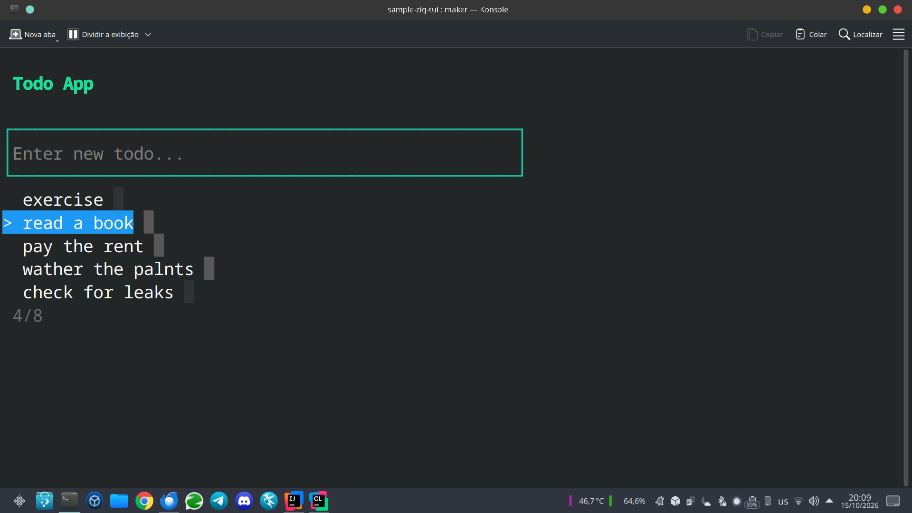

# [A zig tale of TUI and DB][repo]

[repo]: https://github.com/sombriks/sample-zig-tui

Another zig experiment



## Motivation

I want to experiment with zig, simple user interfaces and cool PostgreSQL 
features.

## Tech stack

- Zig 0.17.0
- PostgreSQL 18
- Podman 5.8.7

The following zig libraries are also present:

- zigzag
- pg.zig

## Initial setup

```bash
mrdir sample-zig-tui
cd sample-zig-tui
zig init
mkdir -p src/infra
touch src/infra/database.yml
# as the time of this writing, i did a fork to fix a simple build issue
zig fetch --save git+https://github.com/sombriks/zigzag#main
# as the time of this writing, i did a fork to fix a simple dependency issue
zig fetch --save git+https://github.com/sombriks/pg.zig#master
```

## How to build

```bash
zig build clean
zig build
```

## How to test

```bash
zig build test
```

## How to run

The sample application expects the [sample PostgreSQL database][db] up and 
running. You can spin it up easily with the following command:

[db]: src/infra/database.yml

```bash
zig build db
```

Then you can run the sample app:

```bash
zig build run
```

## Noteworthy

Zig 0.17.0 introduced fewer breaking changes when compared with 0.16.0. The 
build/tooling changes where small.

On the other hand, Evebted/IOUring remains broken, if in need of 
high-performance concurrency, keep relying on [zio][zio].

[zio]: https://github.com/lalinsky/zio

One cool behavior that zig encourages developers to do is to read the 
sources from third-party libraries. It's often a good way to grow repertory 
and solve quick questions. Some projects even include examples in their 
packages, making library sources read even better.

Regarding the lkisten/notify capabilities of postgres, they are neat and 
it's pretty nice that it's available in modern pg clients from zig ecosystem,
running well in the latest release of the language/platform.

It is also noteworthy that the distinct degree of responsibilities in the 
developer hands regarding memory management. Boy, this thing isn't easy for 
someone with decades of experience only with GC-based languages! But it is 
also very rewarding to see the total memory usage in bytes being smaller 
than the process PID number!

All in all, the sample is done for me, there is a memory leak when the program 
aborts, but i'll fix it later. Eventually.

So, if you need hih-performance, good scalability, either up or down, but 
specially down, and have the time, go with zig. It's better than C. 
